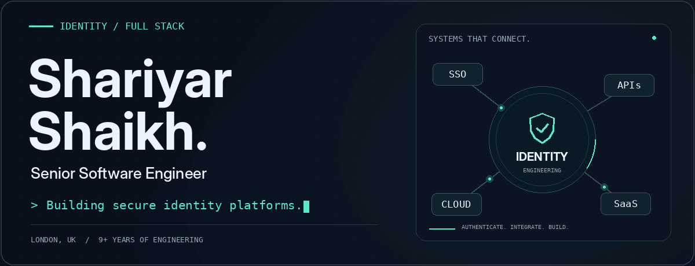
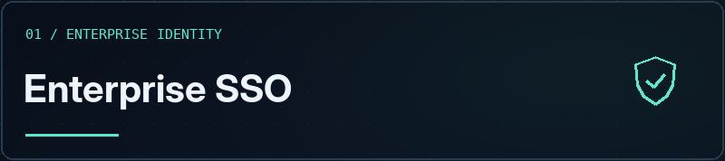
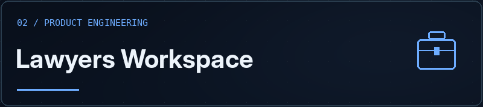
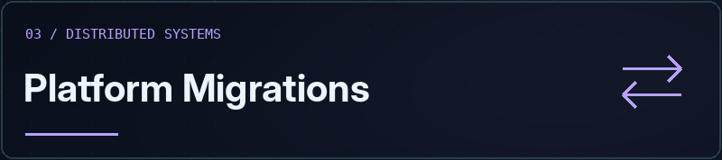
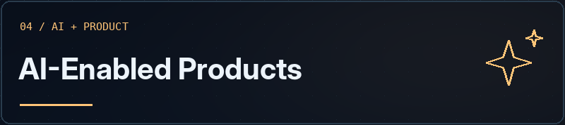

<!-- Profile README for shariyar29. Upload README.md and assets/ together. -->

  <picture>
    <source media="(prefers-reduced-motion: reduce)" srcset="./assets/identity-header.png">
    
  </picture>

  <a href="#selected-work">Selected work</a> &nbsp; / &nbsp;
  <a href="#toolkit">Toolkit</a> &nbsp; / &nbsp;
  <a href="#experience">Experience</a> &nbsp; / &nbsp;
  <a href="https://www.linkedin.com/in/shariyar-shaikh/">LinkedIn</a>

## Secure by design. Built for people.

I'm **Shariyar**, a London-based **Senior Software Engineer with 9+ years of experience** building enterprise SaaS platforms, distributed systems and Identity & Access Management solutions.

At **Spotler Group**, I work on authentication, Single Sign-On, identity federation and integrations across products. My work spans **Java and Spring Boot, C#/.NET, Node.js and NestJS**, alongside **React, Next.js and TypeScript**.

I enjoy connecting the pieces: secure identity, reliable APIs, thoughtful interfaces and the infrastructure that keeps them running.

> Most of my professional work lives in private repositories. The highlights below describe my engineering experience without sharing proprietary code.

## Selected work

<table>
<tr>
<td width="50%" valign="top">

Centralised authentication and identity management across SaaS products, with custom Keycloak extensions and organisation-aware identity provider brokering.

<strong>My work:</strong> Java SPIs, authentication flows, SAML integrations, self-registration, provisioning and platform upgrades.

<code>Keycloak</code> <code>Java</code> <code>OAuth 2.0</code> <code>OIDC</code> <code>SAML</code>

</td>
<td width="50%" valign="top">

A business-management platform I built from scratch, bringing together secure workspaces, dashboards, billing and integrations.

<strong>My work:</strong> Authentication and RBAC, PDF invoices, email outbox, audit actions, Google/Outlook calendar integration, Docker deployment and a Windows installer.

<code>Full stack</code> <code>RBAC</code> <code>Billing</code> <code>Integrations</code>

</td>
</tr>
<tr>
<td width="50%" valign="top">

Fault-tolerant data migration and transformation services to move customers from legacy platforms while maintaining service continuity.

<strong>My work:</strong> REST-based ingestion, data mapping, recurring scheduling and synchronisation without direct access to the source database.

<code>Node.js</code> <code>REST APIs</code> <code>Data transformation</code>

</td>
<td width="50%" valign="top">

AI-powered capabilities in a React-based email editor, paired with performance work to improve the editing experience.

<strong>My work:</strong> AI integration, intelligent layout features, memory profiling and investigation of rendering bottlenecks.

<code>React</code> <code>AI integration</code> <code>Performance</code>

</td>
</tr>
</table>

## Toolkit

A practical toolkit across identity, product development and production delivery.

| Area | Technologies and practices |
| :--- | :--- |
| **Identity & security** | Keycloak, OAuth 2.0, OpenID Connect, SAML, SSO, MFA, RBAC, identity federation, user provisioning, session management |
| **Languages & backend** | Java, Spring Boot, C#, .NET, JavaScript, TypeScript, Node.js, NestJS, REST APIs, microservices |
| **Frontend** | React, Next.js, Redux, Zustand, Tailwind CSS, HTML, CSS |
| **Cloud & delivery** | AWS, Azure, Docker, Kubernetes, TeamCity, GitHub Actions, CI/CD |
| **Data & observability** | SQL Server, MariaDB, MongoDB, Entity Framework, OpenObserve, SQL tuning, memory profiling |
| **Engineering quality** | Cypress, authentication testing, SOLID principles, event-driven workflows, production troubleshooting |

## Experience

| Role | Company | Period |
| :--- | :--- | :--- |
| **Senior Software Engineer** | Spotler Group | May 2022 - Present |
| **Full Stack Engineer** | Kickdynamic | Nov 2020 - Apr 2022 |
| **Senior Software Engineer** | Zensar Technologies | Mar 2019 - Feb 2020 |
| **Software Engineer** | Resemble Systems | Aug 2016 - Feb 2019 |

<strong>Education & certification</strong>

- **Master of Computer Applications** - Acharya Institute of Technology, Bangalore
- **Bachelor of Computer Applications** - Goa University
- **Microsoft Exam 70-486** - Developing ASP.NET MVC Web Applications

 

  Interested in <strong>IAM, security architecture, distributed systems and full-stack engineering.</strong>

